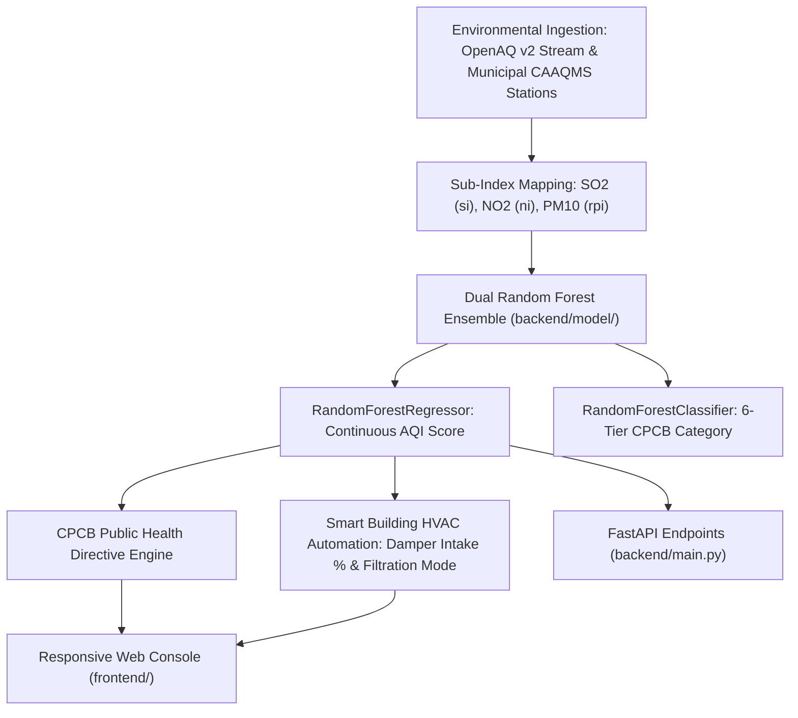

# Indian Air Quality Telemetry & Smart-Building HVAC Control

[](https://indian-air-quality-prediction.vercel.app)


A municipal environmental telemetry platform that predicts the National Air Quality Index (NAQI) according to Central Pollution Control Board (CPCB) standards, generates real-time public health advisories, and outputs automated damper throttling signals for industrial and commercial HVAC systems.

---

## Architecture Flow



---

## Municipal & Industrial Use Case

Severe air pollution across Indian metropolitan hubs (Delhi NCR, Mumbai, Bengaluru, Hyderabad, Kolkata) poses acute public health hazards and causes indoor particulate contamination in commercial buildings.

This system provides automated intelligence for two key sectors:
1. **Public Health Early Warnings**: Calculates CPCB standard air quality categories (Good, Moderate, Poor, Unhealthy, Very Unhealthy, Hazardous) with actionable respiratory advisories for sensitive cohorts and schools.
2. **Smart-Building HVAC Damper Control**: Commercial buildings intake ambient air continuously. During high-pollution events (AQI > 200), the system outputs automated damper throttling directives (reducing intake to 10-30% and maximizing recirculating HEPA filtration), shielding occupants and reducing equipment strain.
3. **Resilient Dual Ingestion**: Connects to the global OpenAQ v2 telemetry network with automatic fallback to verified CPCB municipal station benchmarks during external API rate limiting.

---

## CPCB Air Quality Index Scale

| AQI Band | CPCB Category | Associated Health Impacts | HVAC Automation Directive |
|:---|:---|:---|:---|
| **0 - 50** | **Good** | Minimal impact | 100% fresh air intake, nominal filtration |
| **51 - 100** | **Moderate** | Minor breathing discomfort to sensitive individuals | Standard intake, MERV-13 pre-filters |
| **101 - 200** | **Poor** | Discomfort to people with asthma and heart disease | 60% intake, 40% recirculation |
| **201 - 300** | **Unhealthy** | Noticeable discomfort to general public on prolonged exposure | 30% intake, 70% recirculation, active HEPA |
| **301 - 400** | **Very Unhealthy** | Respiratory illness on prolonged exposure | 10% intake, 90% recirculation, maximum HEPA |
| **401 - 500+** | **Hazardous** | Severe respiratory effects across population | Full emergency isolation, 100% recirculation |

---

## API Endpoints

### 1. Health Verification
```http
GET /health
```
Response:
```json
{
  "status": "healthy",
  "service": "indian-air-quality-prediction",
  "models_loaded": true,
  "features": ["si", "ni", "rpi"]
}
```

### 2. Manual Sensor Parameter Inference
```http
POST /predict
Content-Type: application/json

{
  "features": {
    "si": 45.0,
    "ni": 32.0,
    "rpi": 95.0
  }
}
```

### 3. OpenAQ Live Ingestion with CAAQMS Fallback
```http
GET /predict_by_openaq?city=Delhi&country=IN&lookback_hours=6
```

### 4. Active Metropolitan Stations
```http
GET /api/v1/stations
```

---

## Local Setup & Development

### 1. Backend Service
```bash
cd backend
pip install -r requirements.txt
python -m pytest test_backend.py
uvicorn main:app --host 0.0.0.0 --port 8080 --reload
```

### 2. Frontend Web Console
Open `frontend/index.html` in any modern web browser or serve via:
```bash
npx serve frontend
```
